<div align="center">

# 🛡️ ThreatLens — Cyber-Threat Multitool

### *See the Threat. Understand the Risk. Defend Smarter.*

A web-based cybersecurity threat analysis and security assessment platform for **educational and defensive** purposes.

[](https://omt9ud-8nrxuvu7n-arcadawebapps8.vercel.app/)


🔗 **Live Demo:** [https://omt9ud-8nrxuvu7n-arcadawebapps8.vercel.app/](https://omt9ud-8nrxuvu7n-arcadawebapps8.vercel.app/)

</div>

---

## 📸 Screenshots

<div align="center">


</div>

---

## 📖 Table of Contents

- [Introduction](#-introduction)
- [Problem Statement](#-problem-statement)
- [Proposed Solution](#-proposed-solution)
- [Objectives](#-objectives)
- [Features](#-features)
- [Scope](#-scope)
- [Target Users](#-target-users)
- [System Workflow](#-system-workflow)
- [System Architecture](#-system-architecture)
- [Tech Stack](#-tech-stack)
- [Installation & Setup](#-installation--setup)
- [Security Considerations](#-security-considerations)
- [Testing Strategy](#-testing-strategy)
- [Future Enhancements](#-future-enhancements)
- [Disclaimer](#-disclaimer)
- [Contributing](#-contributing)
- [Author](#-author)

---

## 📌 Introduction

Cybersecurity is essential for organizations, institutions, businesses, and individuals because of the growing number of threats such as malicious IP addresses, suspicious URLs, phishing attacks, malware, and compromised domains.

**ThreatLens** brings commonly needed threat-analysis capabilities into a **single, user-friendly web interface**. Instead of switching between many separate utilities, users can investigate suspicious digital artifacts and make informed security decisions from one dashboard. It uses a transparent local heuristic engine, so risk results are explainable.

---

## ❓ Problem Statement

Analysts and students often juggle multiple tools to investigate URLs, IPs, domains, and files. This causes several problems:

- Security information is spread across different tools.
- Professional tools can be hard for beginners to understand.
- Manual investigation is time-consuming.
- Threat information is hard to organize and interpret.
- Students have few interactive ways to practice threat-analysis concepts.

---

## 💡 Proposed Solution

ThreatLens is a centralized Cyber-Threat Multitool where users submit security-related indicators and analyze them through an interactive dashboard. Analysis is organized into modules covering:

- Threat identification
- Indicator analysis
- Security assessment
- Suspicious URL/domain analysis
- IP-related investigation
- Security awareness and education

---

## 🎯 Objectives

- Build a centralized web-based cybersecurity analysis platform.
- Provide an easy-to-use interface for threat investigation.
- Present results in an understandable, visual format.
- Help students learn practical threat-intelligence concepts.
- Improve awareness of common cyber threats.
- Organize security information systematically.
- Create a scalable architecture for adding future security modules.

---

## ✨ Features

| Module | Description |
|---|---|
| 📊 **Cybersecurity Dashboard** | Total analyses, threat indicators, risk levels, recent investigations, security statistics, and analysis categories |
| 🔗 **URL Analysis** | URL structure, domain information, suspicious characteristics, risk indicators, and security classification |
| 🌐 **IP Address Analysis** | Geographic and network information, reputation, risk classification, and associated indicators |
| 🏷️ **Domain Analysis** | Domain information and reputation, registration-related details, security indicators, and risk assessment |
| 📝 **Text / Phishing Analysis** | Flags phishing language and social-engineering cues in text |
| 📁 **File Scanning** | Checks files for malware-related indicators |
| 🧠 **Threat Intelligence** | Classification: Malicious, Suspicious, Low / Medium / High Risk, Unknown |
| 📈 **Risk Scoring** | `Low Risk → Medium Risk → High Risk → Critical` |
| 📄 **Security Reports** | Submitted indicator, analysis type, findings, risk level, recommendations, timestamp, overall assessment |
| 🕘 **Analysis History** | Previous indicators, dates, results, risk classifications, and investigation types |

> **Note:** Some modules are part of the project roadmap and may still be in development. See [Future Enhancements](#-future-enhancements).

### 🎨 UI Highlights

- Dark, security-themed dashboard
- Threat-level indicators and risk visualizations
- Results tables and security charts
- Navigation sidebar
- Responsive design for desktop and mobile

---

## 📦 Scope

### ✅ In Scope
URL analysis · Domain analysis · IP investigation · Threat indicators · Suspicious activity analysis · Security scoring · Threat classification · Security reports · Dashboard visualization · Educational explanations · Analysis history

### ❌ Out of Scope
Unauthorized access to systems · Credential theft · Malware deployment · Attacking third-party systems · Bypassing security controls · Unauthorized exploitation

---

## 👥 Target Users

- 🎓 **Cybersecurity Students** – learn how indicators are investigated in real environments
- 🔬 **Security Researchers** – organize threat-analysis activities
- 🖥️ **SOC Analysts** – preliminary investigation and indicator triage
- 🛠️ **IT Professionals** – investigate suspicious infrastructure
- 👨‍🏫 **Educators** – demonstrations and practical exercises

---

## 🔄 System Workflow

```mermaid
flowchart LR
    A[User] --> B[ThreatLens Dashboard]
    B --> C[Select Analysis Module]
    C --> D[Submit Security Indicator]
    D --> E[Input Validation]
    E --> F[Threat Analysis]
    F --> G[Threat Intelligence / Security Data]
    G --> H[Risk Assessment]
    H --> I[Result Visualization]
    I --> J[Security Recommendation]
    J --> K[Generate / Review Report]
```



Core idea: **Indicator → Analysis → Intelligence → Risk Assessment → Visualization → Report**

---

## 🏗️ System Architecture

| Layer | Responsibilities |
|---|---|
| **Presentation Layer** | HTML, CSS, JavaScript, React / Next.js, responsive UI components |
| **Application Layer** | User requests, input validation, analysis logic, risk scoring, API communication, report generation |
| **Data / Intelligence Layer** | Threat intelligence sources, security APIs, analysis databases, indicator and historical data |

---

## 🛠️ Tech Stack

| Category | Technologies |
|---|---|
| **Frontend** | HTML5, CSS3, JavaScript, React.js / Next.js |
| **Backend** | Node.js, Python, REST APIs *(proposed)* |
| **Database** | PostgreSQL / MySQL / MongoDB *(proposed)* |
| **Deployment** | Vercel |

---

## 🚀 Installation & Setup

```bash
# 1. Clone the repository
git clone https://github.com/muhammadtalha3893/ThreatLens.git

# 2. Navigate into the project
cd ThreatLens

# 3. Install dependencies
npm install

# 4. Start the development server
npm run dev
```

Open `http://localhost:3000` in your browser.

> If any API keys are required, store them in a `.env` file. **Never commit secrets to the repository.**

---

## 🔐 Security Considerations

ThreatLens is a security tool, so security is built into the design:

- Input validation
- Secure API communication and HTTPS
- Authentication and authorization
- Rate limiting
- Secure API-key storage (never exposed in frontend code)
- Protection against injection attacks
- Secure session management
- Error handling, logging, and monitoring

---

## 🧪 Testing Strategy

- **Functional Testing** – every module works as intended
- **UI Testing** – works across screen sizes
- **Security Testing** – input validation, authentication, API security, common web vulnerabilities
- **Performance Testing** – response times under different loads
- **API Testing** – successful and failed responses from threat-intelligence services
- **User Acceptance Testing** – feedback from students and intended users

---

## 🔮 Future Enhancements

- [ ] User authentication and role-based access control
- [ ] Advanced threat-intelligence integration
- [ ] Malware hash and file reputation analysis
- [ ] Phishing detection and email security analysis
- [ ] Threat correlation and IOC relationship visualization
- [ ] MITRE ATT&CK mapping
- [ ] Automated security reports
- [ ] SIEM integration, SOC dashboard, and alert management
- [ ] Machine-learning-based risk classification

A future version could evolve into a lightweight **Security Operations Center (SOC)** investigation platform.

---

## ⚠️ Disclaimer

ThreatLens is intended **strictly for educational, defensive, and authorized security-analysis purposes**. It uses heuristic analysis and does not guarantee detection of all threats. Do not use it for unauthorized access, exploitation, or attacks on any system. For critical decisions, rely on professional security tools.

---

## 🤝 Contributing

Contributions are welcome!

1. Fork the repository
2. Create a branch: `git checkout -b feature/your-feature`
3. Commit your changes: `git commit -m "Add your feature"`
4. Push the branch: `git push origin feature/your-feature`
5. Open a Pull Request

---

## 👤 Author

**Muhammad Talha**
GitHub: [@muhammadtalha3893](https://github.com/muhammadtalha3893)

---

<div align="center">

⭐ **If you find ThreatLens useful, please star the repository!** ⭐

*See the Threat. Understand the Risk. Defend Smarter.*

</div>
